<p align="center">
  
</p>

<h1 align="center">Comfort Schedule</h1>

<p align="center">
  A Nest-style weekly heat/cool schedule for any Home Assistant thermostat,<br>
  with dashboard cards to run it, edit it and keep an eye on your HVAC.
</p>

<p align="center">
  <a href="https://hacs.xyz"></a>
  
  <a href="LICENSE"></a>
</p>

<p align="center">
  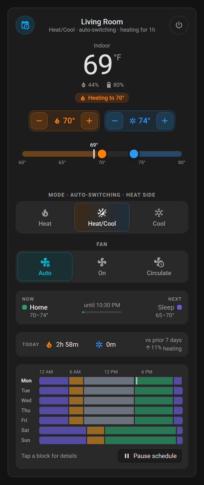
  &nbsp;
  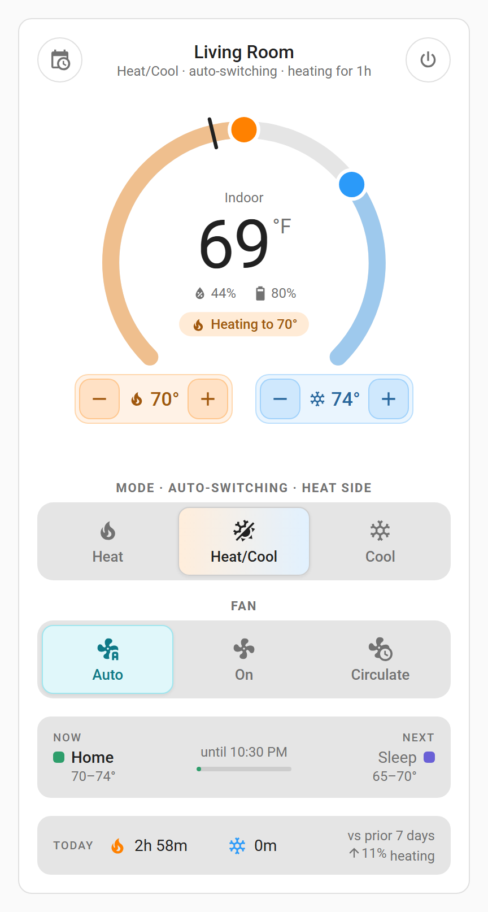
</p>

## Why

Thermostat schedules in Home Assistant usually mean one automation per time change, and they fall apart the moment you switch between Heat, Cool and Heat/Cool. Comfort Schedule replaces all of that with **one schedule that stores both set points for every part of the day**, a wrapper thermostat that keeps them sane, and cards that make it feel like a smart thermostat app.

- 🗓️ **One schedule, both set points.** Each period has a heat and a cool set point, so changing the mode never needs a schedule edit.
- 🔥❄️ **Heat always stays below cool** by a gap you choose, everywhere: the cards, the stock thermostat card, voice, actions and the wall unit.
- 🔁 **Heat/Cool on thermostats that only have Heat and Cool**, by switching between them for you, with limits that stop it flipping back and forth.
- ✋ **Holds** for manual changes: until the next period, for a set time, or until you resume.
- 🩺 **Health warnings** when heating or cooling runs a long time without moving the temperature, or moves it the wrong way.
- 📊 **Runtime tracking**: heating and cooling hours per day, week, month and year, with long-term statistics.
- 🔋 **Battery-friendly.** It writes to the thermostat only when something actually changes, and combines rapid taps into one command.
- 🧩 **Four cards** with visual editors that load on their own. No resources to add.

It works with any `climate` entity that offers Heat and Cool. It's been in daily use on a battery-powered Z-Wave thermostat (Honeywell T6 Pro) with a gas furnace and central AC.

## A tour of the cards

### Thermostat

Set points, mode and fan, what the schedule is doing now and what comes next. Drag the heat and cool handles on the range bar or the dial, or use − / +. Push heat into cool and cool moves up to keep the gap.

<table>
  <tr>
    <td align="center">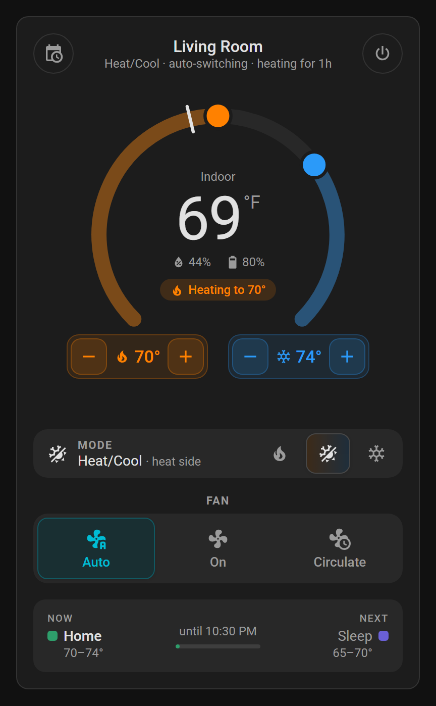<br><sub><b>Dial style</b><br><code>style: dial</code></sub></td>
    <td align="center">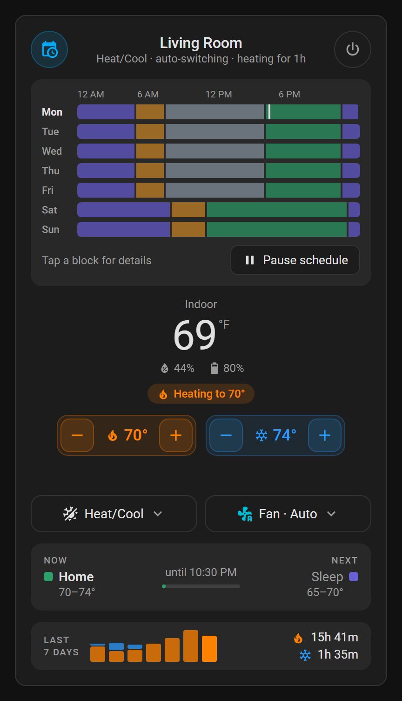<br><sub><b>Compact, week on top, 7-day runtime</b><br><code>layout: compact</code></sub></td>
    <td align="center">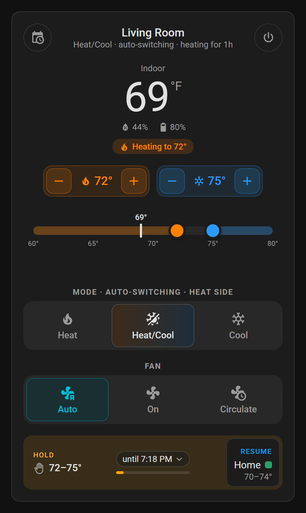<br><sub><b>A hold, with when it ends and what it resumes to</b></sub></td>
  </tr>
</table>

- **Week at a glance** behind the calendar button: every day's blocks, colored by label, with a line at the current time. Tap a block for its details.
- **Holds** show how long they last and what the schedule goes back to. Tap the end time to pick another length, or **Resume** to go back now.
- **Humidity and battery** under the indoor temperature. Battery turns red below 20%.
- **Runtime row** (optional): today's heating and cooling time compared with the week before, or a bar per day for the last 7 days.

### Weekly schedule

See the whole week, then press **Edit** to change it. Drag a block's edges to move it, split and delete blocks, set the heat and cool for each one, and optionally the mode and fan when it starts. Copy a block or a whole day to weekdays, the weekend or every day. Nothing changes until you save.

<p align="center">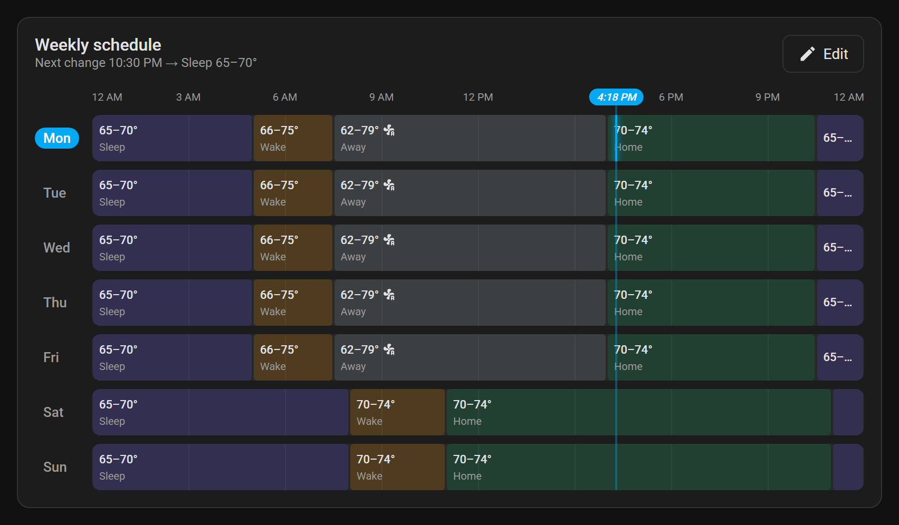</p>

<p align="center">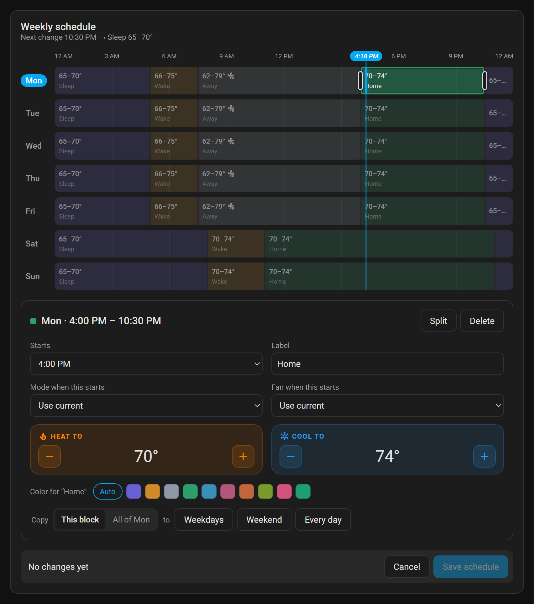</p>

### HVAC health

Indoor temperature against the heat and cool set points, with heating and cooling runs shaded and the schedule underneath. When a run isn't getting anywhere, the card says so, and a warning goes to the notify target you chose and to **Settings › Repairs**. It clears itself once a run makes progress.

<table>
  <tr>
    <td align="center">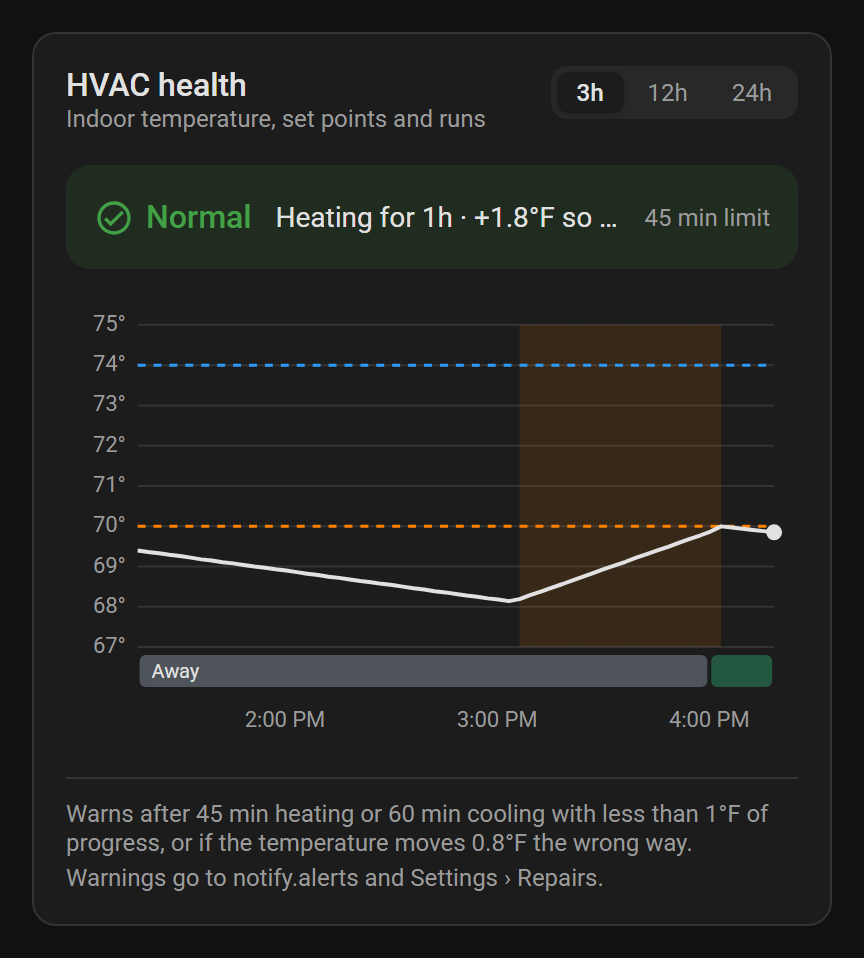<br><sub><b>All good</b></sub></td>
    <td align="center">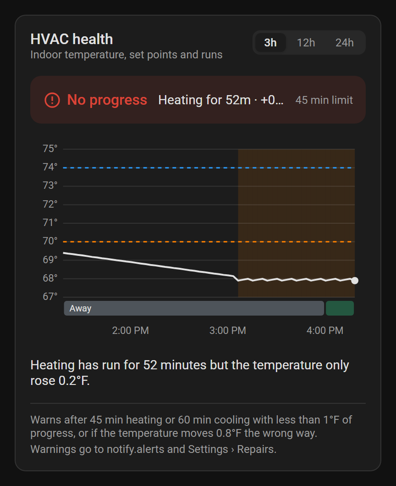<br><sub><b>Heating isn't moving the temperature</b></sub></td>
  </tr>
</table>

Tap any point on the chart to see the temperature, set points, what the system was doing and which block was running at that moment.

### HVAC runtime

Heating and cooling time today, yesterday, the last 7 days, this month and this year, plus a like-for-like comparison with the period before. Switch between days, weeks and months; tap a bar for that day, week or month.

<table>
  <tr>
    <td align="center">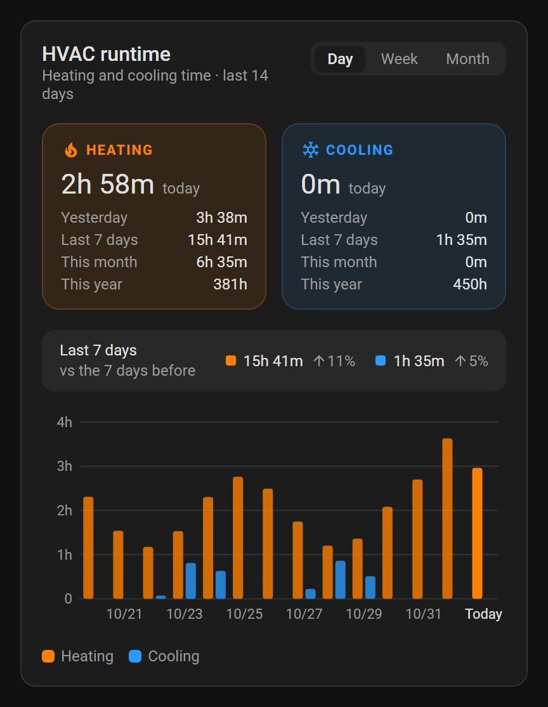<br><sub><b>Day view</b></sub></td>
    <td align="center">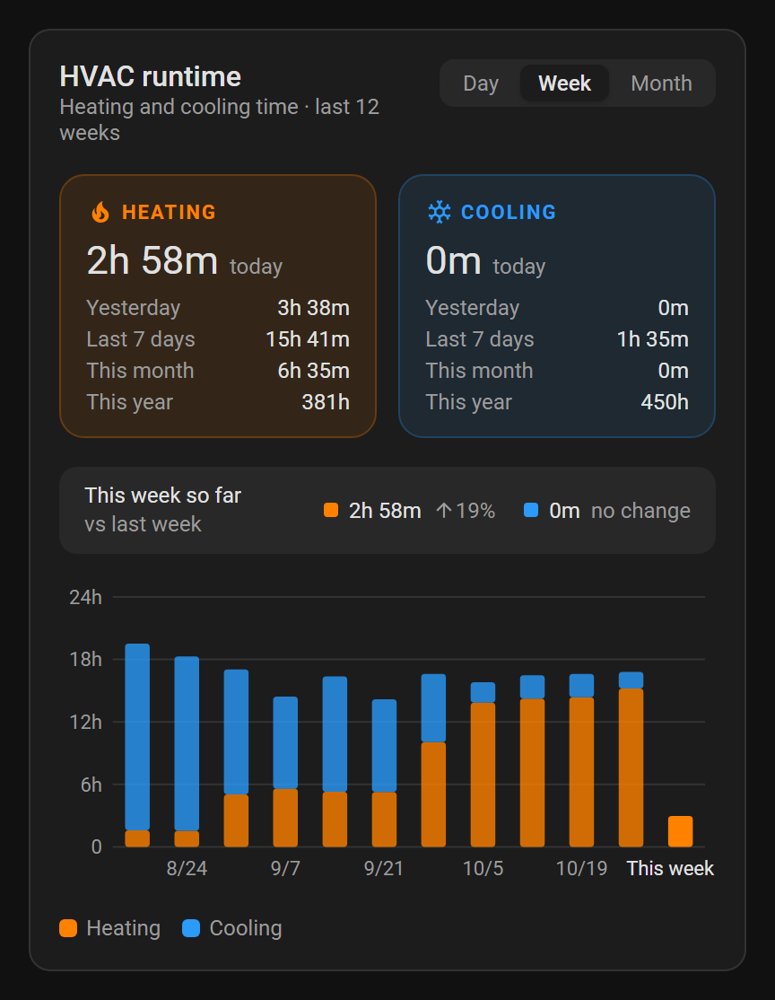<br><sub><b>Week view, stacked</b><br><code>chart_style: stacked</code></sub></td>
  </tr>
</table>

All four cards follow your theme, light or dark.

## Install

### HACS

1. In HACS, open the menu (⋮) › **Custom repositories**, add `https://github.com/InspireNXE/ha-comfort-schedule` with type **Integration**.
2. Search for **Comfort Schedule** in HACS and download it.
3. Restart Home Assistant.

### Manually

Copy `custom_components/comfort_schedule` from this repository to `custom_components/comfort_schedule` in your Home Assistant config folder, then restart Home Assistant.

## Set up

1. If your thermostat has its own built-in schedule, turn it off (often called "non-programmable" or "hold" mode in the thermostat's setup), so the two schedules don't fight.
2. Go to **Settings › Devices & services › Add integration › Comfort Schedule**.
   - **Thermostat:** the thermostat to schedule.
   - **Name:** optional; leave blank to name it after the thermostat (e.g. "Living Room Comfort").
   - **Send HVAC warnings to:** optional notify entity. Warnings also appear under **Settings › Repairs**.
   - **Minimum gap between heat and cool:** at least your thermostat's own auto-changeover deadband (3°F / 1.5°C is a good start).
3. The schedule starts as one period a day at the thermostat's current set points. Open the schedule card and press **Edit** to build your week.

Each thermostat gets its own Comfort Schedule; add the integration again for another one.

## What it adds

After setup there's a new device (named e.g. "Living Room Comfort") with:

| Entity | What it's for |
|---|---|
| `climate.living_room_comfort` | A wrapper thermostat that controls the real one. Use this one on dashboards and with voice. Changing a set point here starts a hold. |
| `switch.living_room_comfort_schedule` | Turns the whole schedule on or off. Turning it on also ends any hold. |
| `sensor.living_room_comfort_period` | The current period (e.g. "Home"), or "Hold" / "Paused". Attributes include the next change. |
| `sensor.living_room_comfort_run_time` | Minutes the current heating or cooling run has lasted. |
| `sensor.living_room_comfort_heating_runtime_today` / `…_cooling_runtime_today` | Hours of heating / cooling today (resets at midnight). Home Assistant keeps long-term statistics, so a Statistics graph card can show daily, weekly or monthly totals. Attributes give yesterday, last 7 days, this month, last 30 days and this year. |
| `binary_sensor.living_room_comfort_hvac_problem` | On when a run isn't moving the temperature toward the set point, or is moving it the wrong way. |

It also adds these actions: `comfort_schedule.set_schedule`, `set_hold`, `resume_schedule` and `pause_schedule`.

## How it behaves

- **Set-point rule.** Heat always stays at least the gap below cool. If you raise heat into cool, cool moves up to keep the gap, and the same happens the other way around.
- **Mode.** The mode comes from the thermostat itself. Every period stores both a heat and a cool set point, so switching between Heat, Cool and Heat/Cool never needs a schedule edit.
- **Heat/Cool on thermostats without it.** If the thermostat only has Heat and Cool, the wrapper thermostat still offers Heat/Cool. It keeps the real thermostat in Heat or Cool. Changing a set point (on the card, by a hold, or by the schedule) switches straight away if the room is already past the new set point. Temperature drift on its own switches only once the room is 1° past the other set point, and at most once every 30 min, so the system doesn't flip back and forth. Changing the mode at the wall unit hands control back to you. Both limits, plus an option to use this even on thermostats with their own Heat/Cool mode, are in the options.
- **Mode and fan per block.** Each block can also set the mode (Off, Heat, Cool, Heat/Cool) and fan when it starts. Both default to "Use current", which leaves whatever is set alone. They're applied when the block starts (and when you resume the schedule, a hold ends, or you change the running block). So if you change the mode by hand mid-block, it stays until the next block. Blocks don't change the mode or fan during a hold.
- **Holds.** A manual change holds until the next period by default. You can change the default in the options, or pick a different length from the card. Changes made at the wall unit or on the original thermostat entity also count as holds.
- **Battery-friendly.** It only writes to the thermostat when something actually differs, and rapid taps on the card are combined into one command.
- **Restarts.** After a restart the current period is applied again. Holds survive restarts.
- **Health.** A warning is raised when heating runs 45 min, or cooling 60 min, with less than 1.0° of progress toward the set point. It's also raised when the temperature moves 0.8° the wrong way during a run (checked after the first 10 min). Warnings go to the notify entity you choose and to **Settings › Repairs**, and they clear on their own once a run makes progress. All thresholds are in the options (**Settings › Devices & services › Comfort Schedule › Configure**).

## Add the cards

The cards load automatically, so there's no resource to add. On a dashboard, choose **Add card** and search for "Comfort", or paste YAML:

```yaml
type: vertical-stack
cards:
  - type: custom:comfort-thermostat-card
    entity: climate.living_room_comfort
  - type: custom:comfort-schedule-card
    entity: climate.living_room_comfort
  - type: custom:comfort-health-card
    entity: climate.living_room_comfort
    hours: 3
  - type: custom:comfort-runtime-card
    entity: climate.living_room_comfort
    days: 14
```

### Card options

Every option below can be set in the card's visual editor, as well as in YAML. The editor groups them into collapsible sections; every card starts with **Appearance** (title, hide title, hide subtitle), followed by that card's own sections (for the thermostat: Temperature and set points, Mode and fan, Schedule, Runtime).

| Card | Option | Default | What it does |
|---|---|---|---|
| All | `entity` | (required) | The Comfort Schedule thermostat, e.g. `climate.living_room_comfort`. |
| | `hide_title` | `false` | Hides the card's title. With `hide_subtitle` too, the header keeps only its buttons, or goes away if it has none. |
| | `hide_subtitle` | `false` | Hides the line under the title. |
| Thermostat | `name` | thermostat's name | Card title. |
| | `style` | `classic` | How the top of the card looks. `classic`: the indoor temperature, large and centered, with the set points under it and the range bar below. `dial`: the indoor temperature inside a ring; drag the heat and cool handles around the ring (or press the ring to move the nearer one), and the set points sit under the ring's two ends (below the dial on narrow cards). |
| | `layout` | `full` | `compact` makes the temperature smaller, drops the range bar (classic) or shrinks the dial, and turns mode and fan into two menu buttons. |
| | `hide_targets` | `false` | Hides the set point controls under the temperature. The range bar or dial still sets them, and the status line still says what it's heating or cooling to. |
| | `hide_target_buttons` | `false` | Keeps the set point values but hides their − / + buttons. Change them on the range bar or dial; in the compact classic layout (no range bar), tap a value for − / +. |
| | `mode_layout` | `buttons` | `compact` is one row like the fan row: the current mode plus an icon button per mode. (The compact card layout uses its own mode menu instead.) |
| | `fan_layout` | `buttons` | `buttons` is a full row of labeled buttons, like the mode row. `compact` is one row: the current fan mode plus an icon button per mode. |
| | `week_expanded` | `false` | Shows the week at a glance when the card loads. The calendar button in the header shows and hides it either way. |
| | `week_position` | `bottom` | Where the week at a glance goes: `bottom` (below the schedule status) or `top` (under the header). |
| | `show_runtime` | `false` | Adds a runtime row under the schedule status. Tap it (or a bar) for more. |
| | `runtime_style` | `today` | `today`: heating and cooling time so far today, plus the change vs the 7 days before for whichever ran more (or its 7-day total, until there's a prior week to compare with). `week`: a small stacked bar per day for the last 7 days, plus the 7-day totals. |
| | `runtime_show` | `both` | `heat` or `cool` shows only heating or only cooling in the runtime row. |
| | `hide_mode` | `false` | Hides the Heat / Heat/Cool / Cool buttons. |
| | `hide_fan` | `false` | Hides the fan control. |
| | `hide_humidity` | `false` | Hides humidity under the indoor temperature. |
| | `hide_battery` | `false` | Hides the battery level under the indoor temperature. |
| | `battery_entity` | detected | Battery sensor to show. The default is the thermostat's own battery sensor. |
| | `humidity_entity` | detected | Humidity sensor opened when you tap the humidity value. The default is the thermostat's own. |
| Schedule | `title` | "Weekly schedule" | Card title. |
| | `read_only` | `false` | Removes the Edit button, e.g. for a wall tablet. Block details still open on tap. |
| Health | `title` | "HVAC health" | Card title. |
| | `hours` | `3` | Hours of history the chart opens with (1–24). The card also has a 3h / 12h / 24h switch for the person viewing it. |
| Runtime | `title` | "HVAC runtime" | Card title. |
| | `show` | `both` | `heat` or `cool` shows only heating or only cooling everywhere on the card, e.g. for a heat-only system. |
| | `totals` | `full` | The heating and cooling tiles at the top. `compact` shows only today's time; `hidden` removes them. |
| | `view` | `day` | What the chart and comparison open with: `day`, `week` or `month`. The card also has a Day / Week / Month switch for the person viewing it. |
| | `chart_style` | `grouped` | `stacked` puts cooling on top of heating, so each bar's height is the combined time. |
| | `days` | `14` | Days in the Day view (7–31). |
| | `weeks` | `12` | Weeks in the Week view (4–12). |
| | `months` | `12` | Months in the Month view (3–12). |
| | `hide_view_switch` | `false` | Hides the Day / Week / Month switch, so the card stays on `view`. It's also hidden when both the chart and the comparison are hidden. |
| | `hide_compare` | `false` | Hides the comparison row (e.g. last 7 days vs the 7 before). |
| | `hide_chart` | `false` | Hides the bar chart and its legend. |
| | `hide_legend` | `false` | Hides the legend under the chart. |

The thermostat card shows humidity and battery under the indoor temperature. Battery turns red below 20%, and tapping either value opens that sensor's details.

The calendar button at the top left of the thermostat card opens the week at a glance: one bar per day, colored like the schedule card, with a line at the current time. Tap a block for its details. It also has the **Pause schedule** / **Resume schedule** button. During a hold, the hold-length menu offers **Pause the schedule** too, which keeps the held set points.

Tap for details works almost everywhere:
- A block on the schedule card (outside Edit mode) or in the week strip shows its details.
- A bar on the runtime chart shows that day, week or month.
- A point on the health chart shows the indoor temperature, set points, what the system was doing (and how far into the run), and the schedule block at that moment. Tap elsewhere on the chart to move it; with a keyboard, Enter opens it and the arrow keys step through time.

The runtime card also compares like with like: in the Day view, the last 7 days against the 7 before; in Week and Month, this week or month so far against the same stretch of the one before. Until runtime has been tracked that far back (right after installing), it says "no earlier data yet" and shows just the totals.

**Block colors.** Each block label has a color, shown on the schedule card, the week strip and the health chart's schedule band. Labels that include sleep/night, wake/morning, away/work or home/evening get a matching default; others get one from a palette. To pick your own, open a block in Edit mode and choose a swatch (or **Auto** to go back to the default). Colors are saved with the schedule. `comfort_schedule.set_schedule` also takes an optional `label_colors` map, e.g. `{"Home": "#2E9E6B"}`.

**Light and dark themes.** The cards use your theme's colors. On light themes, heat/cool/fan text is darkened a little so it stays readable on white.

## Troubleshooting

To see every write and every change detected at the wall, add this to `configuration.yaml`:

```yaml
logger:
  logs:
    custom_components.comfort_schedule: debug
```

Card changes don't show up after an update? Refresh the browser. In the companion app, use **Settings › Companion app › Debugging › Reset frontend cache**.

## Testing changes

`tools/` has test pages that run on a Windows PC with nothing installed: a small PowerShell web server plus pages that run the Python in the browser with Pyodide. See [`tools/README.md`](tools/README.md).

The screenshots in this README come from `tools/screenshots.html` (the cards against a mocked Home Assistant, with real icons). With the test server running, `powershell -ExecutionPolicy Bypass -File tools\screenshots.ps1` regenerates every image in `docs/images/` using headless Microsoft Edge.

## License

MIT. See [LICENSE](LICENSE).
