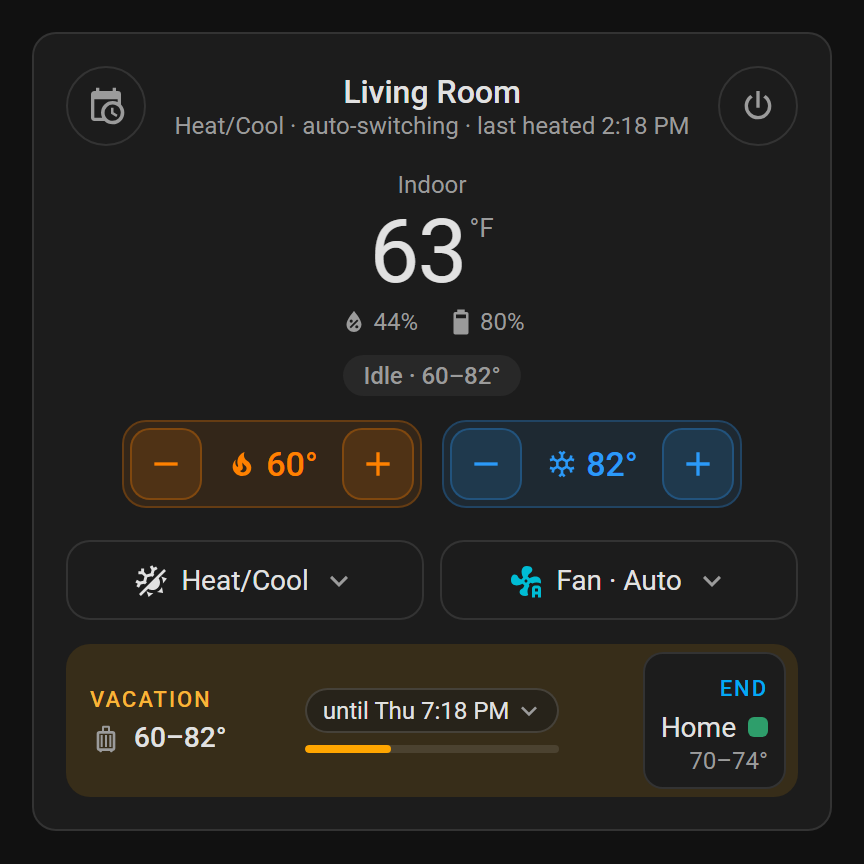

<p align="center">
  
</p>

<h1 align="center">Comfort Schedule</h1>

<p align="center">
  A Nest-style weekly heat/cool schedule for any Home Assistant thermostat,<br>
  with dashboard cards to run it, edit it and keep an eye on your HVAC.
</p>

<p align="center">
  <a href="https://github.com/InspireNXE/ha-comfort-schedule/releases/latest"></a>
  <a href="https://hacs.xyz"></a>
  
  <a href="https://github.com/InspireNXE/ha-comfort-schedule/blob/main/LICENSE"></a>
</p>

<p align="center">
  
  &nbsp;
  
</p>

## Why

Thermostat schedules in Home Assistant usually mean one automation per time change, and they break when you switch between Heat, Cool and Heat/Cool. Comfort Schedule is one schedule with both set points for every part of the day, a wrapper thermostat that keeps them sane, and cards that feel like a smart thermostat app.

- **One schedule, both set points**, so changing the mode never needs a schedule edit.
- **Heat always stays below cool** by a gap you choose, wherever the change comes from.
- **Heat/Cool on thermostats that only have Heat and Cool**, switching for you without flip-flopping.
- **Holds** for manual changes, **vacations** with dates, and **Away** set points when nobody is home.
- **Learns your home**: starts early so the room is ready, and suggests schedule changes you keep making by hand.
- **Health warnings** when runs don't move the temperature, move it the wrong way, or get slower over the weeks. Plus a filter reminder.
- **Runtime tracking** by day, week, month and year, with a cost estimate and weather-adjusted comparison.
- **More than one thermostat** can follow the same schedule.
- **Battery-friendly**: writes only when something changes.
- **Four cards** with visual editors. No resources to add.

Works with any `climate` entity that has Heat and Cool. In daily use on a battery-powered Z-Wave Honeywell T6 Pro with a gas furnace and central AC.

## A tour of the cards

### Thermostat

Set points, mode and fan, and what the schedule is doing now and next. Drag the handles on the range bar or dial, or use − / +. Push heat into cool and cool moves up to keep the gap.

<table>
  <tr>
    <td align="center"><br><sub><b>Dial style</b><br><code>style: dial</code></sub></td>
    <td align="center"><br><sub><b>Compact, week on top, 7-day runtime</b><br><code>layout: compact</code></sub></td>
  </tr>
  <tr>
    <td align="center"><br><sub><b>A hold, with when it ends</b></sub></td>
    <td align="center"><br><sub><b>A vacation</b></sub></td>
  </tr>
</table>

- **Week at a glance** behind the calendar button, with **Pause schedule** / **Resume schedule**. Tap a block for details.
- **Holds** show when they end and what comes next. Tap the end time for another length, or **Resume**.
- **Vacation**: tap the time in the schedule status and pick **Vacation…**. **End** stops it early.
- **Away** and **Starting early** show in the same place when they're in charge.
- **Humidity and battery** under the temperature; tap either for its sensor.
- **Runtime row** (optional): today vs the week before, or a bar per day.

### Weekly schedule

Press **Edit** to drag block edges, split and delete blocks, set heat and cool (and optionally mode and fan), and copy a block or day to weekdays, the weekend or every day. Nothing changes until you save.

<p align="center"></p>

<p align="center"></p>

**Suggestions.** Make the same manual change on 3 days within three weeks and the card offers to schedule it, e.g. "Start Wake at 5:45 AM on weekdays". **Apply** or **Dismiss**.

### HVAC health

Indoor temperature against the set points, with runs shaded and the schedule underneath. Tap the chart for the details at any moment. When a run isn't getting anywhere, the card says so and a warning goes to your notify target and **Settings › Repairs**.

<table>
  <tr>
    <td align="center"><br><sub><b>All good</b></sub></td>
    <td align="center"><br><sub><b>Heating isn't moving the temperature</b></sub></td>
  </tr>
</table>

With an outdoor sensor, the chart adds a dotted outdoor line. Below it: a **getting slower** warning when needed, and the **filter** count with a **Changed it** button.

### HVAC runtime

Heating and cooling time today, yesterday, this week, month and year, with a comparison against the period before. Switch between days, weeks and months; tap a bar for details. Shows a cost estimate if you set one, and with an outdoor sensor a **weather-adjusted** change (hours per degree-day), so a cold week doesn't look like a problem.

<table>
  <tr>
    <td align="center"><br><sub><b>Day view</b></sub></td>
    <td align="center"><br><sub><b>Week view, stacked</b><br><code>chart_style: stacked</code></sub></td>
  </tr>
</table>

## Install

Needs Home Assistant 2026.9 or later.

**HACS:** search for **Comfort Schedule**, download it, and restart Home Assistant. Or open it in HACS directly:

[](https://my.home-assistant.io/redirect/hacs_repository/?owner=InspireNXE&repository=ha-comfort-schedule&category=integration)

**Manually:** copy `custom_components/comfort_schedule` into your config's `custom_components` folder and restart.

## Set up

1. Turn off the thermostat's own schedule (often "non-programmable" or "hold" mode), so the two don't fight.
2. **Settings › Devices & services › Add integration › Comfort Schedule.** Pick the thermostat, and optionally a name, a notify entity for warnings, and the minimum gap between heat and cool (at least the thermostat's own; 3°F / 1.5°C is a good start).
3. The schedule starts as one period a day at the current set points. Press **Edit** on the schedule card to build your week.

Add the integration once per thermostat, or put several thermostats on one schedule with **More thermostats** in the options.

### Options

**Settings › Devices & services › Comfort Schedule › Configure.**

| Section | Option | Default | Notes |
|---|---|---|---|
| | Send HVAC warnings to | none | Warnings also go to Repairs. |
| | Minimum gap between heat and cool | 3°F / 1.5°C | |
| | Manual changes hold | until the next period | |
| HVAC health | Warn if heating / cooling this long without progress | 45 / 60 min | |
| | Progress that counts | 1°F / 0.5°C | |
| | Warn if the temperature moves the wrong way by | 0.8°F / 0.4°C | |
| | Warn when runs get this much slower | 25% | 0 turns it off. |
| Heat/Cool | Switch once the room is this far past the other set point | 1°F / 0.5°C | Only when Comfort Schedule does the switching. |
| | Minimum time between switching | 30 min | |
| | Switch Heat and Cool myself | off | Even if the thermostat has its own Heat/Cool. |
| Presence | People or trackers | none | Anyone home, in a zone, or unavailable counts as home. |
| | Away heat / Away cool | none | Both are needed. |
| | Wait this long after the last person leaves | 10 min | |
| Weather, cost and filter | Outdoor temperature | none | A sensor or weather entity. |
| | Similar weather is within | 10°F / 5.5°C | For early start and the slowdown check. |
| | Degree-day base temperature | 65°F / 18°C | For weather-adjusted runtime. Lower it for a well-insulated home. |
| | Filter reminder after | 300 h | Heating plus cooling hours. 0 turns it off. |
| | Cost per hour of heating / cooling | none | Roughly gas use × gas rate, or AC kW × electricity rate. |
| Learning | Early start | 0 (off) | Up to this many minutes early. |
| | Cold snap: when the forecast low reaches | none (off) | Needs a weather entity as the outdoor temperature. |
| | Cold snap: keep heat within this of the warmest heat | 3°F / 1.5°C | |
| | Suggest schedule changes | on | |
| More thermostats | Also set these thermostats | none | They get the same set points and mode. |
| | Offset for each one | 0° | A second page after saving, e.g. -1° for an upstairs that runs warm. |

## What it adds

A device (e.g. "Living Room Comfort") with:

| Entity | |
|---|---|
| `climate.living_room_comfort` | The wrapper thermostat. Use this one on dashboards and with voice. |
| `switch.living_room_comfort_schedule` | Schedule on or off. Turning it on ends any hold. |
| `sensor.living_room_comfort_period` | Current period, or Hold, Vacation, Away, Paused, or e.g. "Wake (early start)". |
| `sensor.living_room_comfort_run_time` | Minutes the current run has lasted. |
| `sensor.living_room_comfort_heating_runtime_today` / `…_cooling_runtime_today` | Hours today, with long-term statistics for daily, weekly or monthly graphs. |
| `binary_sensor.living_room_comfort_hvac_problem` | On when a run isn't working. |
| `sensor.living_room_comfort_filter_runtime` | Hours since the filter was changed. |
| `binary_sensor.living_room_comfort_filter_change_due` | On when the filter is due. |
| `button.living_room_comfort_filter_changed` | Press after changing the filter. |

### Actions

All target the Comfort Schedule thermostat.

| Action | |
|---|---|
| `comfort_schedule.set_hold` | Hold `heat` and/or `cool`. `duration`: `next_period`, minutes (up to a week), or `indefinite`. |
| `comfort_schedule.resume_schedule` | End any hold and turn the schedule on. |
| `comfort_schedule.pause_schedule` | Stop following the schedule; set points stay. |
| `comfort_schedule.set_schedule` | Replace the week: 7 days, Monday first, each a list of blocks with `start` (minutes after midnight, 5-minute steps, first at 0), `heat`, `cool`, and optional `label`, `mode`, `fan`. Optional `label_colors`. |
| `comfort_schedule.set_vacation` | Hold `heat` and `cool` from `start` (default now) to `end`, then resume. |
| `comfort_schedule.cancel_vacation` | Remove the vacation. |
| `comfort_schedule.filter_changed` | Same as the button. |
| `comfort_schedule.apply_suggestion` / `dismiss_suggestion` | By `id` from the thermostat's `suggestions` attribute. |

```yaml
action: comfort_schedule.set_vacation
target:
  entity_id: climate.living_room_comfort
data:
  start: "2026-12-18 17:00:00"
  end: "2026-12-21 15:00:00"
  heat: 60
  cool: 82
```

## How it behaves

- **What wins:** a hold, then a vacation, then Away, then early start, then the schedule. Resuming a hold during a vacation goes back to the vacation. A vacation also applies with the schedule paused (afterwards the thermostat goes back to its set points from before), and ends any hold from before it.
- **Heat/Cool.** A thermostat with its own Heat/Cool mode keeps it. Otherwise Comfort Schedule switches between Heat and Cool: right away when you change a set point the room is already past, and on drift only once the room is 1° past the other set point, at most every 30 min. Changing the mode at the wall hands control back to you.
- **Mode and fan per block** (optional) apply when a block starts, not during a hold, vacation or Away.
- **Holds** start from any manual change, including at the wall. They survive restarts.
- **Presence.** Away starts once everyone has been gone for the delay, and ends the moment anyone is back. It carries over restarts.
- **Early start** applies the next block's set points early, based on how fast the room has heated or cooled lately (at least 3 runs in 30 days, in similar weather if you have an outdoor sensor). With a weather entity as the outdoor temperature, "similar weather" is the hourly forecast's average until the block, so an evening about to turn cold starts sooner.
- **Cold snap guard.** With a weather entity as the outdoor temperature and a cold snap temperature set, the hourly forecast is checked every 30 minutes. While the low in the next 24 hours is at or below it, each block's heat set point is kept within the cold snap setback (3°F by default) of the warmest heat set point of today and tomorrow: a 62°F night under a 70°F day becomes 67°F, so the house doesn't fall so far that the furnace can't catch up by morning. Holds, vacations and Away are left alone. The thermostat's `cold_snap` attribute shows the forecast low and whether it's on.
- **More thermostats** get the same set points (plus their offset) and mode. Changes made on them directly are put back within 10 minutes. Health and runtime follow only the main thermostat.
- **Health warnings** (all thresholds are in the options):
  - *No progress:* heating 45 min or cooling 60 min with less than 1° of progress.
  - *Wrong way:* 0.8° the wrong way for over 10 min.
  - *Getting slower:* runs over the last two weeks 25% slower than the 60 days before, in similar weather.
  - Each clears on its own when it's no longer true. On very hot days the AC can hold the room flat for an hour; raise the cooling time if that warns often.
- **Filter:** one notification and a Repairs entry when it's due, until you press **Filter changed**.

## Add the cards

They load on their own. **Add card** and search for "Comfort", or:

```yaml
type: vertical-stack
cards:
  - type: custom:comfort-thermostat-card
    entity: climate.living_room_comfort
  - type: custom:comfort-schedule-card
    entity: climate.living_room_comfort
  - type: custom:comfort-health-card
    entity: climate.living_room_comfort
  - type: custom:comfort-runtime-card
    entity: climate.living_room_comfort
```

### Card options

All of these are in each card's visual editor too.

| Card | Option | Default | |
|---|---|---|---|
| All | `entity` | required | The Comfort Schedule thermostat. |
| | `hide_title`, `hide_subtitle` | `false` | |
| Thermostat | `name` | thermostat's name | |
| | `style` | `classic` | `dial` puts the temperature in a ring you drag. |
| | `layout` | `full` | `compact`: smaller, with mode and fan as menus. |
| | `hide_targets`, `hide_target_buttons` | `false` | Hide the set points, or just their − / +. |
| | `mode_layout`, `fan_layout` | `buttons` | `compact`: one row of icons. |
| | `week_expanded` | `false` | Show the week when the card loads. |
| | `week_position` | `bottom` | Or `top`. |
| | `show_runtime` | `false` | Add the runtime row. |
| | `runtime_style` | `today` | Or `week`: a bar per day. |
| | `runtime_show` | `both` | Or `heat` / `cool`. |
| | `hide_mode`, `hide_fan`, `hide_humidity`, `hide_battery` | `false` | |
| | `battery_entity`, `humidity_entity` | detected | |
| Schedule | `title` | "Weekly schedule" | |
| | `read_only` | `false` | No Edit button or suggestions, e.g. for a wall tablet. |
| | `hide_suggestions` | `false` | |
| Health | `title` | "HVAC health" | |
| | `hours` | `3` | Hours shown at first (1 to 24). |
| | `hide_outdoor` | `false` | |
| Runtime | `title` | "HVAC runtime" | |
| | `show` | `both` | Or `heat` / `cool`, e.g. for heat-only systems. |
| | `totals` | `full` | Or `compact` / `hidden`. |
| | `view` | `day` | Or `week` / `month`. |
| | `chart_style` | `grouped` | Or `stacked`. |
| | `days`, `weeks`, `months` | `14`, `12`, `12` | Length of each view. |
| | `hide_view_switch`, `hide_compare`, `hide_chart`, `hide_legend`, `hide_cost` | `false` | |

**Block colors** follow the label (sleep, wake, away, home and so on get matching defaults). Pick your own from a block in Edit mode.

## Troubleshooting

- **Cards didn't update?** Refresh the browser. In the companion app: **Settings › Companion app › Debugging › Reset frontend cache**.
- **Set points keep changing back, or holds start on their own?** The thermostat's own schedule is still on.
- **Heat/Cool switches too often or too late?** Adjust the changeover settings in the options.
- **Health warnings you don't believe?** Raise the time or progress needed in the options.
- **Reporting a problem?** **Settings › Devices & services › Comfort Schedule › ⋮ › Download diagnostics**. Who is home, and whether anyone is, is left out.

For a log of every write, add `custom_components.comfort_schedule: debug` under `logger: logs:` in `configuration.yaml`.

## Testing changes

`python tools/run_emu.py` runs the scenario tests. `tools/` also has browser test pages that need nothing installed on Windows (see [`tools/README.md`](https://github.com/InspireNXE/ha-comfort-schedule/blob/main/tools/README.md)). `tests/` runs against a real Home Assistant on Linux or macOS:

```bash
pip install pytest-homeassistant-custom-component
pytest
```

Both run on every push. `tools\screenshots.ps1` regenerates the screenshots.

## Translations

Only English for now, and translations are welcome. The setup, options, Repairs and actions text is in [`translations/en.json`](https://github.com/InspireNXE/ha-comfort-schedule/blob/main/custom_components/comfort_schedule/translations/en.json): copy it to your language's code (e.g. `de.json`), translate the values, and open a pull request. The cards' text is English only for now.

## License

MIT. See [LICENSE](https://github.com/InspireNXE/ha-comfort-schedule/blob/main/LICENSE).

**How it was made.** Built with AI assistance (Claude), directed and reviewed by me, and tested in daily use on my own system plus the automated tests above.
